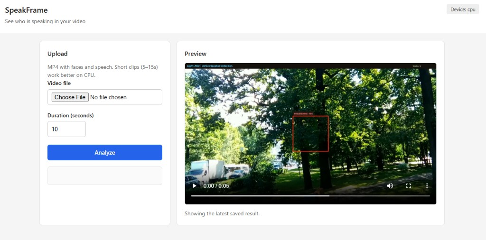

# SpeakFrame

**See who is speaking in your video.** SpeakFrame is a small web app and video overlay pipeline: upload a short clip, detect faces, score who is talking from audio + lip motion, and preview the result in your browser.



**Built in 2025** as a practical wrapper around the active speaker detection stack from the Columbia / AVA demo scripts, with CPU support, MP4 output, and a clean upload UI.

## Features

- **Browser demo** — upload MP4, track job progress, play annotated video (`demo_server.py`).
- **Speaking overlays** — green glow for active speakers, tags with track id and score.
- **CPU or GPU** — auto-detects device (CUDA when available).
- **Short clips** — trim with `--duration` for faster runs on CPU.

## Quick start

**Requirements:** Python 3.10+, [FFmpeg](https://ffmpeg.org/) on your PATH, PyTorch.

```bash
pip install -r requirements.txt
# Face detector weight downloads on first run (S3FD)

python -m uvicorn demo_server:app --host 127.0.0.1 --port 8765
```

Open **http://127.0.0.1:8765/** — upload a 5–15 second clip with **visible faces and speech**.

### CLI (no web UI)

```bash
python Columbia_test.py --videoName myclip --videoFolder demo --duration 10 \
  --pretrainModel weight/finetuning_TalkSet.model
```

Output: `demo/myclip/pyavi/video_out.mp4`

Place `myclip.mp4` in the `demo/` folder first. Pretrained weights ship in `weight/` (not in git — see below).

## Model weights

This repo does **not** commit large `.model` files. Copy them from the upstream release or your existing checkout into `weight/`:

- `pretrain_AVA_CVPR.model`
- `finetuning_TalkSet.model` (recommended for demos)

S3FD face weights download automatically to `model/faceDetector/s3fd/sfd_face.pth` on first detection run.

## Project layout

| Path | Purpose |
|------|---------|
| `demo_server.py` | SpeakFrame FastAPI app |
| `demo/web/` | Static UI |
| `demo/visualization_wow.py` | Overlay drawing |
| `Columbia_test.py` | Full ASd pipeline |
| `DEMO.md` | Extra demo notes |

## Research code

The core network and training scripts follow the published active speaker detection reference implementation. See `RESEARCH.md` for paper links, training, and evaluation commands.

## License

See `LICENSE`. Respect the original authors’ terms for model weights and datasets.